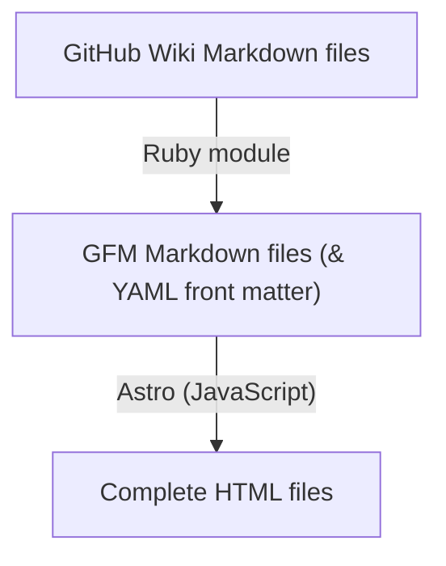

# github-wiki-to-html

[WIP] Convert GitHub Wiki to HTML

> [!NOTE]
> This repository is a **throwaway prototype**; the production project begins in April 2027. We redesign from scratch any time.

## Overview

This project aims to create an internal tool to convert the [Wikinder GitHub Wiki](https://github.com/yuuki7/yuukinder/wiki) to a static HTML site. It can work with any GitHub Wiki, but we do not offer support for external use.

GitHub Wiki originally ran on Gollum, a Ruby wiki system developed by GitHub. The two have since diverged; GitHub Wiki's current backend is proprietary, while Gollum continues as a compatible implementation. Gollum's newer features (such as `__TOC__` and subdirectories) are not reflected in GitHub Wiki.

We only support Markdown articles.

We are considering converting GitHub Wiki Markdown (including the internal link syntax `[[...]]`) to GFM with YAML front matter, and then converting the GFM to HTML with a static site generator (SSG). This makes the wiki article files more interchangeable.

The Ruby library gollum-lib offers no readable API for Markdown-to-Markdown conversion, so we are considering building a separate, compatible Ruby module from a copy of its code (which would also make it easier to port to other languages).

For the SSG, we are considering Astro, which is written in TypeScript.

## Usage

* `bundle exec rake`
Installs project dependencies.
* `bundle exec rake check`
Runs linter and type checks.
* `bundle exec rake build`
Converts Markdown to HTML.
* `bundle exec rake server`
Starts the Astro preview server.

## Workflow

## Directory structure

- `.config/` — Configuration files
  - `.prettierignore` — for prettier to ignore
  - `.prettierrc` — for prettier
  - `.rspec` — for rspec
  - `.rubocop.yaml` — for rubocop
  - `.yardopts` — for yard
  - `Steepfile` — for steep
  - `astro.config.mjs` — for astro
  - `rbs_collection.lock.yaml` — for rbs collection (locked revisions)
  - `rbs_collection.yaml` — for rbs collection
- `.gitignore` — Files git leaves untracked
- `AGENTS.md` — Guidance for coding agents
- `Gemfile` — Ruby dependencies
- `Gemfile.lock` — Locked Ruby dependency versions
- `LICENSE` — License file
- `README.md` — This file
- `Rakefile` — Rake tasks
- `bin/` — Command-line entry point
  - `convert.rb` — Converts wiki to GFM
- `dist/` — The built site (generated)
- `docs/` — YARD documentation (generated)
- `lib/` — Ruby modules
  - `wikinder/`
    - `github/`
      - `wiki.rb` — Orchestration: page collection, rendering, output, git history
      - `wiki/` — Submodules of Wiki
        - `language.rb` — Language detection
        - `meta.rb` — META.md parsing and sync
        - `slugs.rb` — Title/slug conversion and slug safety
        - `tags.rb` — Wikilink and image rewriting into GFM
- `md/` — Converted GFM, the output of bin/convert.rb (generated)
- `package-lock.json` — Locked Node.js dependency versions
- `package.json` — Node.js dependencies
- `sig/` — RBS signatures
  - `commonmarker.rbs`
  - `generated/` — generated by rake check
  - `github/`
    - `markup.rbs`
  - `gollum-lib.rbs`
  - `nokogiri.rbs`
  - `object_to_yaml.rbs` — for Object#to_yaml
  - `rugged.rbs`
  - `whatlanguage.rbs`
  - `wikinder.rbs` — the module's own type aliases
- `site.json` — Site metadata, read by bin/convert.rb
- `templates/` — Astro templates
  - `components/` — Reusable components
    - `Article.astro` — An article with its metadata
    - `ArticleMeta.astro` — Article metadata (author, dates)
    - `BaseHead.astro` — Shared `<head>` elements
    - `Footer.astro` — Site footer
    - `Header.astro` — Site header
    - `LeftSidebar.astro` — Left sidebar
    - `Main.astro` — Main content area
    - `RightSidebar.astro` — Right sidebar
    - `Toc.astro` — Table of contents
  - `content.config.ts` — Content collection schema for the converted Markdown
  - `layouts/` — Page layouts
    - `Base.astro` — Base layout
    - `HomePage.astro` — Layout for the home page
    - `IndividualPage.astro` — Layout for a single article page
    - `Page.astro` — Common page layout
    - `Redirect.astro` — Layout for redirect pages
  - `pages/` — Routes
    - `[slug].astro` — Route for each article page
    - `index.astro` — Route for the top page
  - `styles/` — Stylesheets
    - `page.css` — Page styles
  - `types.ts` — TypeScript types shared by the template
- `test/` — RSpec tests
  - `fixtures/` — Test fixtures
    - `wiki/` — A small seeded wiki used as a fixture
  - `spec_helper.rb` — RSpec setup
  - `support/` — Test support code
    - `fixture_wiki.rb` — Builds a git repository from the fixture wiki
  - `wikinder/`
    - `github/`
      - `wiki.rb` — Tests for Wikinder::GitHub::Wiki

## Development

This project uses the following tools for maintainability:

- **Rubocop**: Linter and code formatter.
- **RBS & Steep**: Static type checker using `rbs-inline` annotations.
