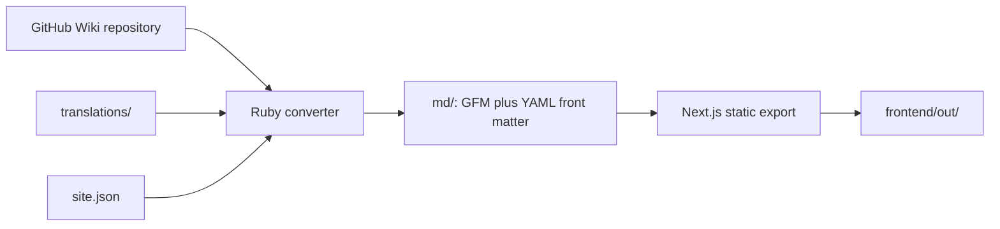

# github-wiki-to-html

[WIP] Convert the Wikinder GitHub Wiki into a static HTML site.

> [!NOTE]
> This repository is a prototype. The production project is planned for April 2027; architecture and implementation may change as experiments provide new evidence.

## Build commands: choose the right one

The full build and the frontend-only build have different inputs:

| Command | Reads | Writes | Use it when |
| --- | --- | --- | --- |
| `bundle exec rake build` | `yuukinder.wiki/`, `translations/`, `site.json` | Updates the wiki's `META.md`, generated `md/`, `.cache/head`, and `frontend/out/` | You want to convert the current wiki and translations, then build the complete site. This is the normal end-to-end build. |
| `bundle exec rake build:site` | The already-converted files in `md/` | `frontend/out/` and formatted frontend source | You intentionally want to build only from the current `md/` snapshot. It does **not** read `translations/` or update `md/`. |
| `bundle exec rake build:convert` | `yuukinder.wiki/`, `translations/`, `site.json` | The wiki's `META.md`, generated `md/`, `.cache/head` | You want to run conversion without building the site. |

A successful `build:site` does not prove that the wiki conversion is current. Conversely, running it against an incomplete or stale `md/` directory can fail with missing translations even when the tracked translation source files are present. Run `bundle exec rake build` when checking the complete pipeline.

`bundle exec rake build` has intentional source-side effects: conversion synchronizes `yuukinder.wiki/META.md` and regenerates `md/` and `.cache/head`. Review those changes after building.

## Setup, checks, tests, and preview

```sh
bundle exec rake setup       # Install Ruby gems, RBS collections, and npm packages
bundle exec rake check       # RuboCop, Ruby signatures/types, and TypeScript types
bundle exec rake test        # Ruby and TypeScript unit tests
bundle exec rake build       # Convert wiki/translations, then export the site
bundle exec rake server      # Serve frontend/out/ at 127.0.0.1:4321
```

`bundle exec rake` with no task is the default setup task. Run setup once per worktree, or again when dependency files change. The Node.js requirement is recorded in `package.json` (`>=26`).

For a frontend-only edit when `md/` is already known to be complete and current, use:

```sh
bundle exec rake check:ts test:ts build:site
```

For a Ruby-only edit, run `bundle exec rake check:ruby` and `bundle exec rake test`. The `test` task runs both the RSpec suite and the TypeScript tests; `test:ts` runs only the latter.

Do not run `bundle exec rake docs` unless documentation generation is specifically required; it rewrites the tracked `docs/` tree.

## Pipeline



The Ruby converter turns GitHub Wiki Markdown, including supported Gollum-style wiki links, into standard GFM with YAML front matter. `translations/` contains hand-maintained translation source files; they are inputs to conversion, not direct Next.js input. Next.js reads the generated `md/` tree and exports static HTML suitable for static hosting.

The project is primarily for the Wikinder Wiki. The converter may work with other GitHub Wiki repositories, but external use is not a supported responsibility. Markdown pages are supported; other wiki formats are out of scope.

Original-language articles use root-level URLs such as `/Hello-world`; translations use language-prefixed URLs such as `/ja/Hello-world`. See [translations/README.md](translations/README.md) for translation file rules.

## Repository layout

- `bin/`, `lib/` — Ruby conversion entry point and library.
- `yuukinder.wiki/` — Wiki repository used as converter input (Git submodule).
- `translations/` — Hand-maintained translated wiki Markdown, read during conversion.
- `md/` — Generated GFM and front matter consumed by Next.js; do not treat this as the translation source.
- `frontend/` — Next.js/React application, TypeScript code, static assets, and exported site in `out/`.
- `scripts/` — Build helpers, including copying wiki assets into the export.
- `test/`, `frontend/tests/` — Ruby and TypeScript tests.
- `sig/` — RBS signatures for Ruby type checking.
- `site.json` — Site URL, language, and other site metadata.
- `Rakefile`, `AGENTS.md` — Project tasks and contributor/agent instructions.

## Development tools

RuboCop formats/lints Ruby, RBS and Steep validate Ruby signatures/types, TypeScript checks the frontend, Node's built-in test runner runs TypeScript tests, and Prettier formats frontend source. Use the Rake tasks above for project checks and builds so their ordering and side effects are explicit.
