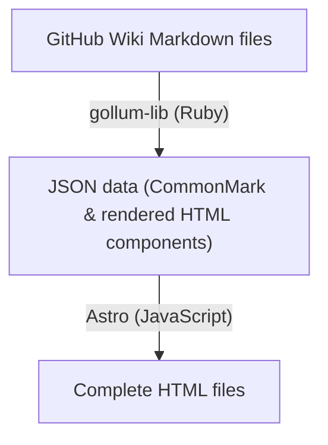

# github-wiki-to-html

Converts GitHub Wiki into a static site.

## Workflow

## Background

GitHub Wiki was originally powered by Gollum, but its current backend is proprietary, while the Gollum project continues as an open-source compatible implementation. This project uses `gollum-lib` to parse the Markdown files into JSON data, and Astro as a static site generator (SSG) to build the HTML files.

## Usage

* **`bundle exec rake`**
Installs project dependencies.
* **`bundle exec rake check`**
Runs linter and type checks.
* **`bundle exec rake build`**
Executes the check pipeline, converts Markdown to HTML.
* **`bundle exec rake server`**
Starts the Astro preview server.

## Development

This project uses the following tools for maintainability:

- **Rubocop**: Linter and code formatter.
- **RBS & Steep**: Static type checker using `rbs-inline` annotations.
