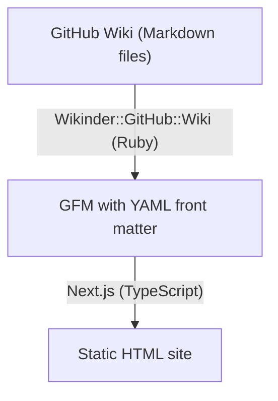

# github-wiki-to-html

[WIP] Convert GitHub Wiki to HTML

> [!NOTE]
> This repository is a **throwaway prototype**; the production project begins in April 2027. We change direction or redesign from scratch at any time based on rational thinking grounded in new discoveries or experiments.

## Usage

All commands in this project run through Rake; the tasks are defined in the `Rakefile`. Do not call the underlying tools, such as `bundle install` or `npm`, directly.

* `bundle exec rake`
Installs Ruby & NPM dependencies and the RBS collection. This is a synonym for `bundle exec rake setup`; run it first, before the other commands, and again whenever the dependency files change.
* `bundle exec rake check`
Runs linter and type checks.
  * `bundle exec rake check:ruby`
  Runs the Ruby linter and type checks only.
  * `bundle exec rake check:ts`
  Runs the TypeScript type check only.
* `bundle exec rake test`
Runs the RSpec and TypeScript unit tests.
  * `bundle exec rake test:ts`
  Runs the TypeScript unit tests only.
* `bundle exec rake build`
Converts wiki to HTML site. This reads the wiki submodule, `translations/` and `site.json`. As side effects, the conversion synchronizes the wiki's `META.md` and regenerates `md/` and `.cache/head`; review those changes after building.
  * `bundle exec rake build:md`
  Converts the wiki to Markdown only.
  * `bundle exec rake build:site`
  Builds the site from the converted Markdown only. `bundle exec rake build:md` must have been run at least once beforehand.
* `bundle exec rake docs`
Builds docs.
* `bundle exec rake server`
Starts preview server.

For a change that only touches the frontend, `bundle exec rake check:ts test:ts build:site` runs just the check, the tests and the build for that side (but `bundle exec rake build:md` must have been run at least once beforehand).

Ruby ~> 4.0 and Node.js >= 26 are required; the requirements are recorded in the `Gemfile` and `package.json`.

## Directory structure

- `.config/` — Tool configuration files
- `bin/`
  - `convert.rb` — Ruby script to convert GitHub Wiki to GFM
- `docs/` — YARD documentation
- `lib/` — Ruby modules
- `md/` — Generated GFM converted from GitHub Wiki
- `sig/` — RBS signatures
- `scripts/` — Build scripts
- `frontend/` — Next.js (React) frontend: source, configuration and static assets, with the built static site in `frontend/out/`
- `test/` — RSpec tests; the TypeScript tests live in `frontend/tests/`
- `translations/` — Hand-maintained translated GFM by coding agent
- `yuukinder.wiki/` — The GitHub Wiki repository, as a Git submodule; the converter's input
- `AGENTS.md` — Guidance for coding agents
- `Gemfile` — Ruby dependencies
- `Gemfile.lock` — Locked Ruby dependency versions
- `LICENSE` — License file
- `README.md` — This file
- `Rakefile` — Rake tasks
- `package-lock.json` — Locked NPM dependency versions
- `package.json` — NPM dependencies
- `site.json` — Site metadata

## Overview

This project aims to create an internal tool to convert the [Wikinder GitHub Wiki](https://github.com/yuuki7/yuukinder/wiki) to a static HTML site. It can work with any GitHub Wiki, although we do not offer support for external use.

GitHub Wiki originally ran on Gollum, a Ruby wiki system developed by GitHub. The two have since diverged; GitHub Wiki's current backend is proprietary, while Gollum continues as a compatible implementation. Gollum's newer features (such as `__TOC__` and subdirectories) are not reflected in GitHub Wiki.

We only support Markdown articles.

We are considering converting GitHub Wiki Markdown (including the internal link syntax `[[...]]`) to GFM with YAML front matter, and then converting the GFM to HTML with a static site generator (SSG). This makes the wiki article files more interchangeable.

The Ruby library `gollum-lib` offers no readable API for Markdown-to-Markdown conversion, so we are considering building a separate, compatible Ruby module from a copy of its code (which would also make it easier to port to other languages).

For the SSG, we use Next.js (React), which is written in TypeScript.

An article URL looks like `/Hello-world`. Its Japanese translation is at `/ja/Hello-world`. So the original is at the root, and a translation starts with its language code. The translations are written by a coding agent and supplied as data under `translations/`. See `translations/README.md` for details.

## Development

This project uses the following tools for maintainability:

- RuboCop: Ruby linter and formatter.
- RBS & Steep: Ruby type checking.
- Prettier: HTML/CSS/JS/TS formatter.
- TypeScript: Frontend type checking; its unit tests use Node's built-in test runner.
