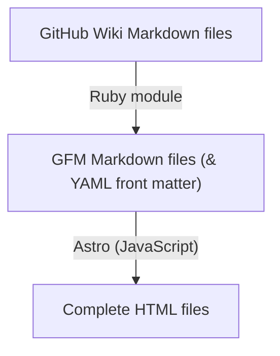

# github-wiki-to-html

[WIP] Convert GitHub Wiki to HTML

> [!NOTE]
> This repository is a **throwaway prototype**; the production project begins in April 2027. We redesign from scratch any time.

## Overview

This project aims to create an internal tool to convert the [Wikinder GitHub Wiki](https://github.com/yuuki7/yuukinder/wiki) to a static HTML site. It can work with any GitHub Wiki, but we do not offer support for external use.

GitHub Wiki originally ran on Gollum, a Ruby wiki system developed by GitHub. The two have since diverged; GitHub Wiki's current backend is proprietary, while Gollum continues as a compatible implementation. Gollum's newer features (such as `__TOC__` and subdirectories) are not reflected in GitHub Wiki.

We only support Markdown articles.

We are considering converting GitHub Wiki Markdown (including the internal link syntax `[[...]]`) to GFM with YAML front matter, and then converting the GFM to HTML with a static site generator (SSG). This makes the wiki article files more interchangeable.

The Ruby library gollum-lib offers no readable API for Markdown-to-Markdown conversion, so we are considering building a separate, compatible Ruby module from a copy of its code (which would also make it easier to port to other languages).

For the SSG, we are considering Astro, which is written in TypeScript.

## Usage

* `bundle exec rake`
Installs project dependencies.
* `bundle exec rake check`
Runs linter and type checks.
* `bundle exec rake build`
Converts Markdown to HTML.
* `bundle exec rake server`
Starts the Astro preview server.

## Workflow

## Development

This project uses the following tools for maintainability:

- **Rubocop**: Linter and code formatter.
- **RBS & Steep**: Static type checker using `rbs-inline` annotations.
