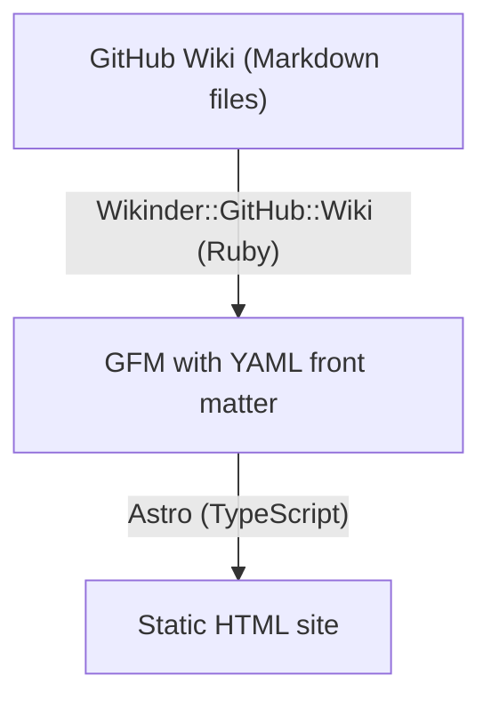

# github-wiki-to-html

[WIP] Convert GitHub Wiki to HTML

> [!NOTE]
> This repository is a **throwaway prototype**; the production project begins in April 2027. We change direction or redesign from scratch at any time based on rational thinking grounded in new discoveries and experiments.

## Usage

* `bundle exec rake`
Installs project dependencies.
* `bundle exec rake check`
Runs linter and type checks.
* `bundle exec rake test`
Runs unit tests.
* `bundle exec rake build`
Converts wiki to HTML site.
* `bundle exec rake docs`
Builds docs.
* `bundle exec rake server`
Starts the preview server.

## Overview

This project aims to create an internal tool to convert the [Wikinder GitHub Wiki](https://github.com/yuuki7/yuukinder/wiki) to a static HTML site. It can work with any GitHub Wiki, although we do not offer support for external use.

GitHub Wiki originally ran on Gollum, a Ruby wiki system developed by GitHub. The two have since diverged; GitHub Wiki's current backend is proprietary, while Gollum continues as a compatible implementation. Gollum's newer features (such as `__TOC__` and subdirectories) are not reflected in GitHub Wiki.

We only support Markdown articles.

We are considering converting GitHub Wiki Markdown (including the internal link syntax `[[...]]`) to GFM with YAML front matter, and then converting the GFM to HTML with a static site generator (SSG). This makes the wiki article files more interchangeable.

The Ruby library gollum-lib offers no readable API for Markdown-to-Markdown conversion, so we are considering building a separate, compatible Ruby module from a copy of its code (which would also make it easier to port to other languages).

For the SSG, we are considering Astro, which is written in TypeScript.

An original page is published at the site root, and each translation under its language's code. The converter does not produce translations. They are supplied as data under `translations/` and built like the originals. See `translations/README.md` for how translations are supplied and how the site's languages are declared.

## Directory structure

- `.config/` — Configuration files
- `AGENTS.md` — Guidance for coding agents
- `Gemfile` — Ruby dependencies
- `Gemfile.lock` — Locked Ruby dependency versions
- `LICENSE` — License file
- `README.md` — This file
- `Rakefile` — Rake tasks
- `bin/` — Command-line entry point
  - `convert.rb` — Converts wiki to GFM
- `dist/` — Converted site (generated)
- `docs/` — YARD documentation (generated)
- `lib/` — Ruby modules
- `md/` — Converted GFM (generated)
- `package-lock.json` — Locked Node.js dependency versions
- `package.json` — Node.js dependencies
- `sig/` — RBS signatures
- `site.json` — Site metadata, including the site's languages
- `templates/` — Astro templates
- `test/` — RSpec tests
- `translations/` — Translated pages, one directory per language
- `tsconfig.json` — TypeScript configuration
- `tsconfig.scripts.json` — TypeScript configuration for the browser scripts

## Development

This project uses the following tools for maintainability:

- **RuboCop**: Linter and formatter for Ruby.
- **RBS and Steep**: Type checking for Ruby, from `rbs-inline` annotations in the code.
- **TypeScript**: Type checking for the templates and browser scripts, through `astro check` and `tsc`.
- **Prettier**: Formatter for the templates and the built site.
