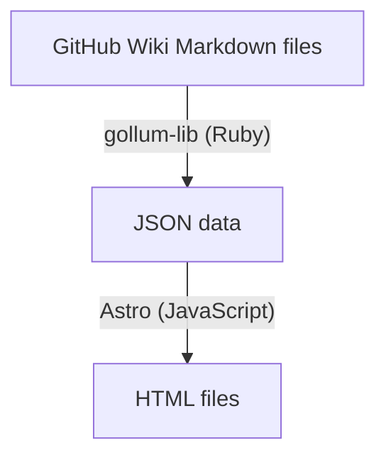

# github-wiki-to-html

Converts GitHub Wiki Markdown files into HTML files.

## Workflow

## Background

The GitHub Wiki backend is proprietary, and the Gollum project aims to provide a compatible implementation. This project uses `gollum-lib` to parse the Markdown files into JSON data, and Astro as a static site generator (SSG) to build the HTML files.
