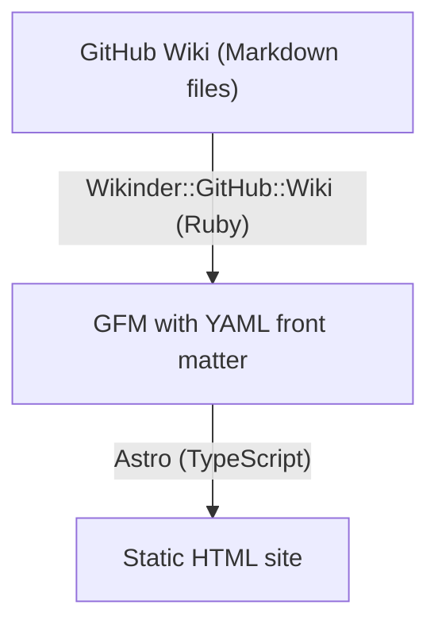

# github-wiki-to-html

[WIP] Convert GitHub Wiki to HTML

> [!NOTE]
> This repository is a **throwaway prototype**; the production project begins in April 2027. We change direction or redesign from scratch at any time based on rational thinking grounded in new discoveries or experiments.

## Usage

* `bundle exec rake`
Installs project dependencies.
* `bundle exec rake check`
Runs linter and type checks.
* `bundle exec rake test`
Runs unit tests.
* `bundle exec rake build`
Converts wiki to HTML site.
* `bundle exec rake docs`
Builds docs.
* `bundle exec rake server`
Starts preview server.

## Overview

This project aims to create an internal tool to convert the [Wikinder GitHub Wiki](https://github.com/yuuki7/yuukinder/wiki) to a static HTML site. It can work with any GitHub Wiki, although we do not offer support for external use.

GitHub Wiki originally ran on Gollum, a Ruby wiki system developed by GitHub. The two have since diverged; GitHub Wiki's current backend is proprietary, while Gollum continues as a compatible implementation. Gollum's newer features (such as `__TOC__` and subdirectories) are not reflected in GitHub Wiki.

We only support Markdown articles.

We are considering converting GitHub Wiki Markdown (including the internal link syntax `[[...]]`) to GFM with YAML front matter, and then converting the GFM to HTML with a static site generator (SSG). This makes the wiki article files more interchangeable.

The Ruby library `gollum-lib` offers no readable API for Markdown-to-Markdown conversion, so we are considering building a separate, compatible Ruby module from a copy of its code (which would also make it easier to port to other languages).

For the SSG, we are considering Astro, which is written in TypeScript.

An article URL looks like this: `/Hello-world`. Its Japanese translation is at `/ja/Hello-world`. So the original has no language code, and a translation starts with its language's code. The translations are written by coding agents and supplied as data under `translations/`. See `translations/README.md` for details.

## Directory structure

- `.config/` — Tool configuration files
- `bin/`
  - `convert.rb` — Ruby script to convert GitHub Wiki to GFM
- `dist/` — HTML files generated by Astro from GFM
- `docs/` — YARD documentation
- `lib/` — Ruby modules
- `md/` — GFM generated by Ruby script
- `sig/` — RBS signatures
- `templates/` — Astro templates
- `test/` — RSpec tests
- `translations/` — Translated GFM by coding agents
- `AGENTS.md` — Guidance for coding agents
- `Gemfile` — Ruby dependencies
- `Gemfile.lock` — Locked Ruby dependency versions
- `LICENSE` — License file
- `README.md` — This file
- `Rakefile` — Rake tasks
- `package-lock.json` — Locked Node.js dependency versions
- `package.json` — Node.js dependencies
- `site.json` — Site metadata
- `tsconfig.json` — TypeScript configuration
- `tsconfig.scripts.json` — TypeScript configuration for browser scripts

## Development

This project uses the following tools for maintainability:

- **RuboCop**: Ruby linter and formatter.
- **RBS and Steep**: Ruby type checking.
- **Prettier**: HTML/CSS/JS/TS/Astro formatter.
